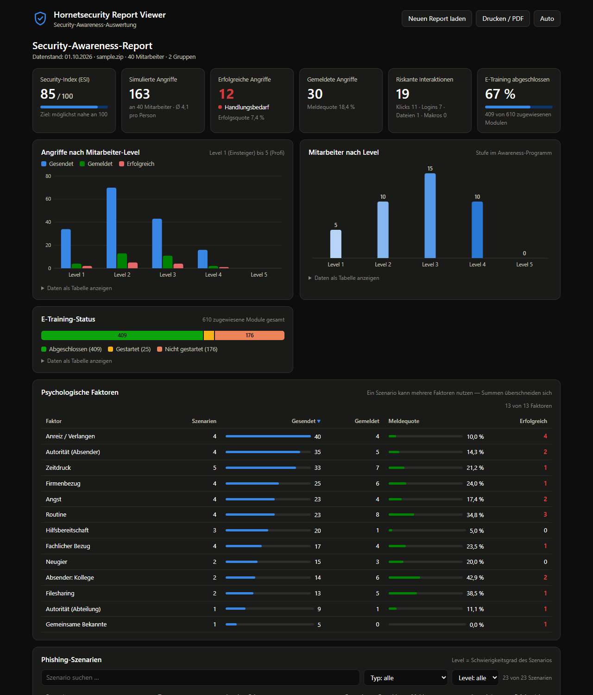

# Hornetsecurity Report Viewer

[](https://github.com/Computerhof/Hornetsecurity-Report-Viewer/actions/workflows/ci.yml)
[](https://github.com/Computerhof/Hornetsecurity-Report-Viewer/releases/latest)
[](LICENSE)

Macht aus dem monatlichen Report des **Hornetsecurity Security Awareness Service** (ZIP mit vier
CSV-Dateien) ein übersichtliches, interaktives Dashboard. Es ist eine einzige HTML-Datei:
Sie installieren nichts, alles läuft offline im Browser, und es verlassen keine Daten den Rechner.

> *English:* A portable, offline, single-file HTML dashboard for the monthly statistics export
> of the Hornetsecurity Security Awareness Service. Drop the report ZIP onto the page — nothing
> is uploaded. The UI is in German.



*Dashboard mit dem erfundenen Beispiel-Report aus `test/sample.zip` (dunkles Farbschema).*

## Download

**[→ Neueste Version herunterladen](https://github.com/Computerhof/Hornetsecurity-Report-Viewer/releases/latest)**:
`Hornetsecurity-Report-Viewer.html` aus dem Release speichern. Die SHA-256-Prüfsumme steht im
Release (`SHA256SUMS.txt`).

## Benutzung

1. `Hornetsecurity-Report-Viewer.html` **doppelklicken**. Die Datei öffnet sich im Standard-Browser
   und kann beliebig kopiert werden, z. B. auf den Desktop oder ein Netzlaufwerk.
2. Die **Report-ZIP aus der Hornetsecurity-Mail per Drag & Drop** auf die Seite ziehen
   (oder klicken und die Datei auswählen). Die vier CSV-Dateien funktionieren auch einzeln.
3. Dashboard prüfen. Mit **„Drucken / PDF"** lässt sich der Report archivieren.

Für einen neuen Monat ziehen Sie einfach die neue ZIP auf die bereits geöffnete Seite.

Zum Ausprobieren ohne eigenen Report eignet sich [`test/sample.zip`](test/sample.zip), ein
vollständig erfundener Beispiel-Report.

### Was das Dashboard zeigt

| Bereich | Inhalt |
| --- | --- |
| **KPI-Kacheln** | ESI (Employee Security Index) mit Vormonats-Delta, simulierte / erfolgreiche / gemeldete Angriffe, Meldequote, riskante Interaktionen (Klicks, Logins, geöffnete Dateien, Makros), E-Training-Fortschritt |
| **Diagramme** | Angriffe und Meldungen je Mitarbeiter-Level, Mitarbeiter-Verteilung, E-Training-Status |
| **Monats-Verlauf** | ESI, Melde- und Erfolgsquote über die Monate (ab dem zweiten geladenen Report) |
| **Tabellen** | Psychologische Faktoren, Phishing-Szenarien, Gruppen (ab zwei Gruppen) und Mitarbeiter: sortierbar, durchsuchbar, filterbar; erfolgreiche Angriffe rot markiert |
| **Darstellung** | Hell/Dunkel (folgt dem System, umschaltbar), Druckansicht, farbfehlsichtigkeits-geprüfte Diagrammfarben |

### Systemvoraussetzungen

Ein aktueller Browser: Microsoft Edge, Google Chrome, Mozilla Firefox oder Safari.
Ohne Internetverbindung, ohne Server, ohne Administratorrechte.

## Datenschutz

- Die Auswertung läuft **vollständig lokal** im Browser. Die Seite lädt nichts nach und sendet nichts.
- Für den Monats-Verlauf speichert der Browser **nur Kennzahlen** (ESI, Quoten, Summen), keine
  Namen oder E-Mail-Adressen, im `localStorage`. Löschen über „Monats-Verlauf zurücksetzen"
  in der Fußzeile.
- Report-Inhalte gelangen ausschließlich als Text in die Seite (`textContent`), nie als HTML.
  Ein manipulierter Report kann deshalb keinen Code einschleusen.

## Erwartetes Eingabeformat

Der Statistik-Export des Security Awareness Service, z. B. `security_awareness_service_statistics.zip`:

| Datei | Inhalt |
| --- | --- |
| `company_statistics.csv` | Firmen-Gesamtwerte (ESI, Angriffe, Level 1–5, E-Trainings) |
| `group_statistics.csv` | Dieselben Werte je Gruppe |
| `user_statistics.csv` | Werte je Mitarbeiter |
| `phishing_scenario_statistics.csv` | Werte je Phishing-Szenario |

Fehlt eine Datei, zeigt die Seite einen Hinweis und berechnet die Kennzahlen, soweit möglich,
aus den Benutzerdaten. Als **Datenstand** gilt das Erstellungsdatum der ZIP-Einträge (meist
Monatsanfang; die Daten betreffen dann den Vormonat).

Format-Eigenheiten, die der Viewer berücksichtigt: Listenfelder im Python-Stil
(`"['fear', 'time_pressure']"`), Quoten als Dezimalzahl mit Punkt, UTF-8 ohne BOM
(Windows-1252 als Rückfallebene).

## Entwicklung

```text
src/
├── core.js        ZIP-Leser, DEFLATE (puff-Port als Fallback), CSV-Parser, Datenmodell (in Node testbar)
├── ui.js          Rendering: KPI, SVG-Diagramme, Tabellen, Tooltips, Verlauf, Drag & Drop
└── template.html  Gerüst und CSS (Farbsystem hell/dunkel, Druck-Styles)
test/
├── core.test.js   Tests: Inflate-Fuzz gegen zlib, ZIP-/CSV-Grenzfälle, Datenmodell-Sollwerte
├── gates.test.js  Tests der Doku-Gate-Regeln
├── make-sample.js Generator für den synthetischen Beispiel-Report (deterministisch)
└── sample.zip     Synthetischer Beispiel-Report (nur erfundene Daten)
scripts/
├── check-data.js  Daten-Gate: nur erlaubte Pfade, keine echten Reportdaten
├── check-docs.js  Doku-Gate: Doku passt zum Code (PR-Check)
├── lint-md.js     markdownlint-Lauf über alle Markdown-Dateien
└── lint-ps.ps1    PSScriptAnalyzer-Lauf über alle PowerShell-Skripte
build.ps1          setzt core.js + ui.js + Version ins Template ein → dist/Hornetsecurity-Report-Viewer.html
```

```powershell
npm ci              # Entwicklungswerkzeuge (Linter) installieren
npm run gate:data   # Daten-Gate
npm run gate:docs   # Doku-Gate
npm run check       # Syntax-Prüfung
npm run lint        # ESLint, markdownlint, PSScriptAnalyzer
npm test            # Tests (müssen „0 fehlgeschlagen" melden)
.\build.ps1         # Build → dist/Hornetsecurity-Report-Viewer.html
```

Voraussetzungen: Node.js ≥ 22.13 und PowerShell. npm-Pakete gibt es nur als Entwicklungswerkzeuge;
die ausgelieferte HTML-Datei hat keine Abhängigkeiten.
Die Version steht ausschließlich in `package.json` und wird beim Build in die Fußzeile übernommen.

### Qualitäts-Gates

Jeder Pull Request muss in der [CI](.github/workflows/ci.yml) alle Checks bestehen, bevor er
nach `main` gemergt werden kann:

1. **Daten-Gate:** Die eingecheckte Beispiel-ZIP muss byte-gleich aus dem Generator stammen.
   Alle Dateien, auch die Inhalte der ZIP, dürfen nur E-Mail-Adressen erlaubter Domains
   enthalten, und nur Pfade der Positivliste sind zulässig. Die `.gitignore` arbeitet ebenfalls
   mit einer Positivliste.
2. **Syntax-Prüfung** aller Skripte.
3. **Test-Suite** (ZIP/DEFLATE-Fuzzing, CSV-Parser, Datenmodell, Robustheit).
4. **Build und Build-Prüfung:** Die HTML-Datei ist eigenständig (keine externen Skripte), und
   Version sowie Lizenzhinweis sind enthalten.
5. **Lint:** ESLint für JavaScript, markdownlint für die Dokumentation, PSScriptAnalyzer für
   die PowerShell-Skripte.
6. **Doku-Gate:** Produktänderungen brauchen einen CHANGELOG-Eintrag, Änderungen an
   Werkzeugen und Abläufen eine angepasste Entwickler-Doku. npm-Skripte, Links und
   CHANGELOG-Struktur werden auf Konsistenz geprüft.
7. **Abhängigkeiten prüfen:** Neue oder geänderte Pakete und Actions dürfen keine bekannten
   Sicherheitslücken und keine GPL/AGPL-Lizenz mitbringen.

Dependabot hält npm-Pakete und Actions aktuell (wöchentlich, gebündelt, Sicherheitsupdates
sofort). Details zu allen Checks stehen in [CONTRIBUTING.md](CONTRIBUTING.md#pull-request-checks).

Releases baut der [Release-Workflow](.github/workflows/release.yml) aus einem Tag `vX.Y.Z`. Er
bricht ab, wenn Tag und `package.json` nicht übereinstimmen.

### Technische Notizen

- ZIP-Dekompression nativ über `DecompressionStream('deflate-raw')`, mit einer
  pure-JS-DEFLATE-Implementierung als Fallback (Port von zlib „puff", gegen `node:zlib` fuzz-getestet).
- Diagramm-Rendering über `setTimeout` statt `requestAnimationFrame`, damit es auch in
  Hintergrund-Tabs und eingebetteten Vorschauen zuverlässig zeichnet.
- `window.PRV` ist ein Test-Hook für automatisierte Browser-Tests (`loadFile`, `state`, `version`).

Mehr dazu in [CONTRIBUTING.md](CONTRIBUTING.md). Sicherheitsthemen: [SECURITY.md](SECURITY.md).

## Lizenz und Kontakt

© 2026 **chrive-solutions e.U.**, veröffentlicht unter der
[PolyForm Shield License 1.0.0](LICENSE).

- **Erlaubt:** den Viewer kostenlos nutzen, privat und in der Firma, auch verändert für eigene Zwecke.
- **Nicht erlaubt:** ein Produkt anbieten, das mit dem Viewer konkurriert, also den Viewer oder eine
  veränderte Fassung verkaufen, weitergeben oder als Dienst anbieten, auch kostenlos. Dafür ist eine
  Vereinbarung mit chrive-solutions e.U. nötig.

Diese Kurzfassung ist unverbindlich; maßgeblich ist der englische Lizenztext in [LICENSE](LICENSE).
Die PolyForm Shield License ist keine Open-Source-Lizenz im Sinne der OSI: Der Quelltext ist offen
einsehbar, die Weitergabe ist eingeschränkt. Version 1.0.0 wurde unter der MIT-Lizenz veröffentlicht
und bleibt unter dieser Lizenz.

Kontakt: [office@chrive-solutions.at](mailto:office@chrive-solutions.at) ·
[chrive-solutions.at](https://chrive-solutions.at)

---

*Unabhängiges Projekt, nicht mit der Hornetsecurity GmbH verbunden und nicht von ihr unterstützt.
„Hornetsecurity" ist eine Marke ihres jeweiligen Inhabers und wird hier nur genannt, um das
unterstützte Eingabeformat zu beschreiben.*
